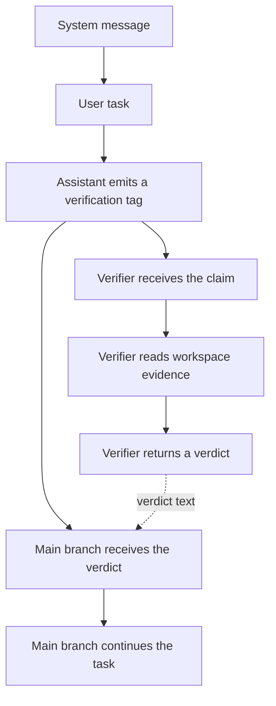

# Reflect design

## The coding loop

`refl` sends the active conversation to the OpenAI-compatible chat endpoint in `llama-server`. The model can inspect UTF-8 files with `read_file` and `grep_search`, run Bash commands with `bash`, and make changes with `write_file` and `edit_file`. `read_file` returns as many whole numbered lines as fit in its 12,000-character output limit and then says where to continue. It used to stop at 80 lines, and a 27B model with 131,072 tokens of context then spent 7 of a turn's 20 requests reading a 492-line file, lines 1 to 80, 81 to 160, and so on. The same file now takes two reads. A single line longer than the limit, such as minified code, is cut, so a read always moves on. When the server reports image input in `/props`, the model can also look at an image with `view_image`. The tool returns a short description and the image as a data URL, and the session keeps both. A fork does not get the main branch's images: each one is replaced by a note that the fork can look at it with `view_image`. In a real session, every critic and verifier request carried the main branch's 600 KB screenshot. Each request sends the description as the tool result and the images in a user message after the tool results of that reply, since every chat template with image input accepts images in a user message, while not every one renders them in a tool result. Qwen3.8's template renders both. llama-server decodes images with stb_image, so the tool takes PNG, JPEG, GIF, and BMP files of up to 32 MiB and 64 megapixels, Basalt's limits, and asks for a conversion of anything else, such as SVG or WebP. Without image input the tool is not offered, and a note replaces any image that a resumed session holds. Reflect executes calls in the order they appear and returns each observation with the corresponding tool call ID. The terminal lists each call with its command, path, or search pattern. The system prompt asks the main branch to tell the user, before each group of tool calls, what it is about to do and why, and briefly what it found. That text, which a reply carries beside its tool calls, shows as chat with a `»` mark. Before, Reflect showed only processing lines, and in one session a model wrote no such text beside any of its 8 tool calls, because its reasoning went into the hidden thinking block. Verification, the plan challenge, and strategic reflection each end with one summary line. Their steps, such as each critic, verifier, moderator ruling, and reviewer, show only with `--verbose`, and the session file keeps them all. A main-branch reply's thinking shows above its tool calls, cut to its last six lines without `--verbose`.

While a task runs, a status panel keeps the bottom rows of the terminal through a scroll region, so other output scrolls above it and the panel is drawn at fixed rows. The first version moved the cursor up as many lines as it had drawn to clear itself, and a wrapped line then left old panel lines and blank rows behind in a live run. The engine reports its phase, counts such as `critics=(4, 6)`, and `actor=(name, doing, tone)` for every critic, reviewer, verifier, the moderator, and the main branch through an `on_progress` callback. While the panel shows, every request streams with `stream: true`, and each piece reports its actor's tokens, tokens per second, kind, thinking, writing, or a tool call, and latest words. On Basalt, 73 streamed pieces carried 76 tokens, so a piece counts as a token. The client joins the pieces into the same message a whole reply gives, so the engine works the same with and without the panel. `/slots` could not give these numbers per reflector, because it does not say which session a slot serves, and it counts other clients' requests. The panel still polls it for the busy slots and to redraw twice a second. Two forecasts were dropped. An estimate from the average length of earlier replies showed a few seconds throughout plan checks that took minutes, because short structured fork answers pulled the average down and a reply with thinking can be a hundred times longer than the one before. An upper bound from each slot's token limit was true but showed several minutes for replies that took seconds, and another client's request set it. In a live run of the slugify task, the plan check took 9 minutes 16 seconds with thinking in every fork and 1 minute 55 seconds with `--thinking main`. The model continues until it returns a final answer or reaches the request limit.

The session stores each tool result as JSON. Requests give it to the model as plain text: the output, preceded by an `Error:` or `Exit code:` line when present. In a JSON string, file contents carry escapes such as `\"` and `\n`. A 4B model copied those escapes into `edit_file` arguments, which then did not match the file. With plain-text results, its replayed edits matched the file in 24 of 34 cases instead of 9 of 41.

`edit_file` first looks for a literal match. If there is none, it accepts a unique match that differs only in blank lines and trailing spaces, with indentation unchanged, and says so in its result. The 4B model often copied a block with one blank line where the file had two. Replayed through this fallback, 24 of 34 failed edits from three of its benchmark rounds succeeded. An `old_text` that starts with the line numbers from `read_file` gets an error saying to leave them out.

Some chat templates, such as Gemma 4's, render an assistant's text after the results of its tool calls and close the turn there. The model then reads its stated plan after the result and repeats the call. Before the first request, Reflect renders a short probe conversation through `llama-server`'s `/apply-template` endpoint. If the template moves the text, Reflect sends each reply that has both text and tool calls as two consecutive assistant messages. These templates join them into one model turn in the original order. The saved session keeps the reply as one message. A server without the endpoint gets the messages unchanged.

Reflect talks to `llama-server` through a small HTTP client built on Python's `http.client`, so it needs no packages beyond the standard library. Each request opens its own connection in a worker thread, which lets the three reviewers of a batch wait on the server at the same time. A cancelled request, such as one past a benchmark deadline, closes its socket so the thread stops waiting for the reply. Connecting allows 5 seconds, and reading the reply allows `--timeout`. Windows lists `::1` before `127.0.0.1` for `localhost` and takes two seconds to give up on an address where nothing listens, while `llama-server` listens on `127.0.0.1` by default. The client therefore tries the address that accepted its last connection first, then IPv4 addresses before IPv6 ones.

At startup Reflect reads the context size per slot from `/props`, naming the model so that a router answers for it. After each main-branch request it compares the reported `usage.total_tokens`, the prompt and the reply together, with that size and warns once at 75% and once at 90%. Forks do not trigger the warning, since a reviewer that sees only a brief uses far less context. When `llama-server` rejects a request with `exceed_context_size_error`, Reflect reports the tokens the request needed and the slot's size. It suggests restarting the server with more context per slot and continuing with `--resume`, because Reflect does not shorten conversations yet. Basalt rejects a request whose prompt and `max_tokens` together exceed the slot, with an `invalid_request_error` that names both. Reflect reads both numbers from its message and also suggests a lower `--max-tokens`.

Every completion request carries an `x-session-id` header: the session name for the main branch, and the session name with the ID of the fork's first node for each verifier and reviewer. Basalt uses it to keep a session on one slot, so the main conversation can reuse its cached context after a batch of concurrent forks. Each fork has its own ID, so concurrent forks do not compete for one session's slot.

Requests think by default: `--thinking auto` leaves the choice to the chat template, and Qwen3.8's template thinks. Thinking used to be off by default, because on a 27B model at about 45 tokens per second, a request that thinks through its full budget waits about three minutes before it acts, and two 27B models solved every natural benchmark task without thinking as well as with it. Thinking costs that time, but in the benchmark a reflection with thinking solved a task that the model never solved alone, while without thinking the model rarely acted on what the reviewers found. `--thinking main` thinks on the main branch only, and `--thinking off` sends `enable_thinking: false` in `chat_template_kwargs` for every request.

A reasoning model that keeps thinking until it reaches `--max-tokens` returns no answer, and the turn stops with "Completion reached its token limit". Each request with thinking therefore sends a thinking budget in `reasoning_budget_tokens`. When the budget is used up, `llama-server` writes Reflect's `reasoning_budget_message`, which says that the model will act on its best plan so far, then closes the thinking block, and the model writes its answer. The default budget is half of `--max-tokens`, because an answer can be long. Asked for an SVG of a pelican riding a bicycle, Huihui-Qwen3.8-27B thought for about 5,950 tokens and then wrote the 5 KB file in a reply of about 2,650 tokens. With the earlier defaults, 2,048 output tokens and a budget that left 1,024 of them for the answer, the file did not fit. Coding tasks can need more thinking than that drawing, so the default `--max-tokens` is now 16,384, with 8,192 tokens each for thinking and the answer, and the default `--timeout` is 600 seconds. If an answer is cut off anyway, the main branch discards the reply, tells the model the limit, and asks it to think more briefly and to split a large file into several writes. A second cut-off reply in the same task stops the turn. With the old limit of 2,048 tokens, the model thought until the budget again and the retried reply was cut off too, so the retry helps only when the answer has room. The reply does not say that the budget ran out, so Reflect detects its own message at the end of `reasoning_content` and reports it in the terminal. The server ignores the budget for templates without a thinking block.

The forks can think at a different effort from the main branch. With `--fork-effort`, each verifier and reviewer request that thinks carries `reasoning_effort`, and the server passes it to the chat template. When it loads a template, `llama-server` renders it with each common level and reports in `/props` the levels that render differently from an unknown level, lowest first, and the levels that make the template raise an error. Of several levels that render alike, it keeps the highest, so Qwen3.8's template lists `low`, `medium`, and `xhigh`, its default, and treats `high` as `xhigh`. Reflect lists those levels at startup. It stops on a rejected level, because the server would refuse every fork request, and warns about a level that is not in the list. Skipping thinking in the forks stays with `--thinking main`, so `--fork-effort none` is refused. How closely a model follows the level depends on the model. On two short reasoning questions, Huihui-Qwen3.8-27B used fewer tokens at its default, `xhigh`, than at `low` or `medium`, so a lower level does not always save time.

Reflect builds the system prompt for each request from its current instructions, the project's `REFLECT.md`, and the list of project skills. A resumed session therefore follows the current instructions and the current `--linear`, `--no-verify`, and `--thinking` settings.

The CLI and file tools use Python filesystem APIs on all platforms. PowerShell and MSYS2 launch the same CLI. The `bash` tool invokes Bash from the workspace directory. On Windows, Bash can come from MSYS2 or Git for Windows. Reflect writes each command to a temporary file and lets Bash run it with `eval`, not as a `-c` argument. On Windows, MSYS2 and Git Bash read their command line with quoting rules of their own that halve backslashes: a Python heredoc meant to write `"%s\n"` into a Lua file wrote a line break into the string instead, and MAME refused the script. The command line also holds 32 KB at most, too little for a large heredoc. `eval` keeps the messages that `-c` gives, such as `bash: line 3: ...`, so they do not name the file, and the stall detector still sees the same output for the same failure. When a command times out, Reflect ends Bash together with the programs it started, with `taskkill /T` on Windows and from the parent IDs that `ps` lists elsewhere. Ending Bash alone left them running: an emulator run piped through `tail` kept a CPU core busy after its call had timed out. `grep_search` runs `rg` when it is on `PATH`. Otherwise a Python search follows the same rules: it skips hidden and binary files, takes the file list from `git ls-files` so that `.gitignore` applies inside a Git repository, cuts lines at 300 characters, and returns up to 30 matches. Its patterns use Python's regex syntax, which agrees with ripgrep's for common patterns, but not for every pattern. A test compares both searches when ripgrep is installed.

The launch directory is the workspace unless `--workspace` selects one explicitly. An empty workspace can start a session. The file tools preserve existing instructions and configuration from other coding agents, and allow writes in their skill directories. Bash runs with the launching user's permissions and receives the project's preservation rule as model guidance.

## Conversation trees

Each session starts with a system message and a main branch. Each node records its ID, parent ID, branch type, status, and the chat message, including any tool calls or tool results. The `main_head` in the session file points to the active conversation node. Following parent IDs back to the root and reversing that path reconstructs the conversation for a given branch.



Solid arrows are parent links in the saved tree. The dotted arrow is the verdict copied into the main conversation. A fork's tool calls and observations remain on its branch. Nodes from a fork with a usable result are marked `merged`. Forks that fail or exhaust the request budget are marked `pruned` and retained in the session for inspection.

Reflect writes UTF-8 JSON to `.refl/sessions/<session-id>.json` at startup, when it accepts a prompt, and after each completed model and tool round. It writes to a temporary file in the same directory and replaces the session file once the snapshot is complete. The session ID includes a UTC timestamp and a unique suffix. Session files can hold prompts, file contents, and command output, so Reflect adds a `.gitignore` to `.refl/sessions/` and `.refl/strategies/` that keeps Git from tracking them in any workspace. It leaves an existing `.gitignore` in those directories unchanged.

```text
refl --workspace ./project --resume SESSION_ID "Continue with the next step."
```

Resuming copies the saved tree into a new session file and continues from the saved active node. The copied tree includes earlier forks. A saved turn interrupted before a final answer is closed with a brief transcript note when the next prompt begins. The CLI prints the new session ID at startup.

`/tree` displays every branch and marks the current node. The newest continuation of a node stays at the same indentation, and earlier branches such as forks are indented above it. `/checkout <node_id>` can select a main, verification, or reflection node. The next prompt extends the selected path, and earlier branches remain visible in the tree. If the selected node falls inside a tool round, Reflect adds skipped results for tool calls still awaiting a result. The next task operates on the workspace as it exists when the task starts.

## Verification forks

1. The main model sees the entire conversation along the active path. Its system prompt asks it to emit `<verify>specific claim</verify>` before relying on an unchecked assumption about a file, API, or config key.
2. After the model reply completes, Reflect extracts distinct nonempty claims from its visible text. Tool calls accompanying a tag receive a deferred observation. The model can reissue a call after seeing the verdict. A claim already checked in the current task keeps its verdict until a main-branch Bash command or file change could alter the evidence, so restating it in a final answer ends the turn.
3. Reflect forks from the latest main node and adds an instruction naming the claim. Each verifier receives the conversation up to the fork point with a verification-specific system prompt. Multiple claims in one reply start concurrently. `llama-server` schedules them on its available slots.
4. Each verifier gets up to three model requests. It can locate evidence with `read_file` or `grep_search`. Reflect also checks the tool name before dispatch, so any attempted shell command or write stays unexecuted.
5. Once a lookup succeeds, a verdict request contains the claim and the fresh workspace evidence. It uses `llama-server`'s JSON response format to request an explanation and a status of `supported`, `contradicted`, or `insufficient`. Reflect displays these as `VERIFIED`, `FALSE ASSUMPTION`, and `UNVERIFIED`. A useful explanation cites the file and line. If the request budget runs out or the server fails to provide a usable verdict, Reflect passes back `UNVERIFIED`.
6. Reflect adds the verdicts to the main conversation and requests the next main response. Any further edits or commands run through the main branch's regular tool loop.

`--no-verify` omits the verification instruction and skips verification forks while keeping strategic reflection and the plan challenge. `--linear` skips all kinds of forks.

The verdict records the model's interpretation. The saved tool observation gives reviewers access to the evidence behind it. Live tests with a small model showed that a correct file read can still lead to an incorrect verdict label.

Verification tests can exercise a claim that changes after an edit. Start with `status.txt` containing `old_ready`, check the claim with a tag, and let the main branch replace the value. Resume the session and check the old claim again. In the saved tree, the initial verdict should precede the edit, and the later verifier should report the old claim as false.

## Plan challenge

Verification checks claims that the model names, and reflection starts after a stall. Neither looks at a plan before the model acts on it. The plan challenge does, at the point where a plan turns into its first change. Reflect detects that point itself, so the challenge does not depend on a model that remembers to announce its plan.

1. When a main-branch reply makes the task's first `write_file` or `edit_file` call to a path outside `.refl/`, Reflect defers the calls of that reply, as for a verification tag. Skills and strategy notes record work and do not start a challenge, and neither do files in other hidden folders, which hold scratch files, such as a test harness in `.tmpcheck/`. In a real session, that harness got a full plan check, and nothing held up. Hidden folders of project configuration, such as `.github/`, still start one. Neither does a small edit, one whose old and new text, or whose written content and the file it replaces, each have at most 3 lines and 200 characters. In a live test, a one-line edit of `status.txt` took several minutes of challenge: four critics and three verifiers argued about a trailing newline that `edit_file` keeps anyway, and none of the objections could be proven. Making a small edit and running the check costs less. A skipped small edit leaves the challenge for the task's first larger change. Writing a few lines over a large file is not small, because it removes the rest.
2. Six critics fork from that reply in `challenge` branches and see the whole conversation, including the pending change. Each gets one request with `read_file` and `grep_search`, with a tool call required, and one request for a structured answer. Requirements, Environment, Edge cases, Security, and Quality are asked to assume that the plan fails. Security looks for a hole the change opens: input that gets executed, a command, query, or path built from input, a secret, a weakened check, or downloaded code that runs. Quality looks for what makes the code harder to keep correct, not for matters of taste. Their answer names the objection, its evidence, a check, and a likelihood.
3. The sixth critic, Simpler plan, does not object. A plan grows step by step, and each step can look reasonable while the whole is more than the task needs. So the simplifier first restates the goal at the highest level of abstraction, what must be true when the task is done, without the steps of the current plan. Its answer schema lists `goal` first, so the model writes the abstraction before it proposes anything. Then it derives the simplest strategy that reaches that goal with what the workspace and the system already provide, names what the strategy relies on, and lists every requirement and how the strategy keeps it. When the current plan already follows that strategy, it leaves the strategy empty.
4. Each finding goes to a verifier as soon as it is ready. An objection becomes the claim that the planned change fails for that reason. Only `supported` makes it proven. `contradicted` and `insufficient` drop it, because an opinion against the plan must rest on proven facts. Passing unproven objections on had one benefit in a live test: their checks made the model look through the workspace, where it found a helper to reuse. That nudge is gone. Whether a simpler strategy will work is a prediction that no file shows yet, and the first live test returned `insufficient` for that reason. So its claim states the facts the strategy rests on: that the workspace has what it relies on, and that the request, spec, and tests require nothing beyond the requirements it lists. Only a `supported` strategy reaches the main branch, because a simpler plan that drops a requirement does more harm than none.
5. A moderator rules on every proven finding in one request without tools. The verifier only says whether a finding's facts are true, not whether its conclusion follows from them or whether following it serves the user's request. In a live test, an objection's fact was true, the data had unpadded dates, while its conclusion was wrong, because the plan already used a helper that handles them. The moderator decides that, only from the facts the reflectors cited and the verifier confirmed, measured against the user's request. Its fork sees nothing but the request, the planned change, and the numbered findings, so it cannot bring in facts of its own. For each finding it rules `follow`, `dismiss`, or `ask_user`, and gives the reason first, naming the fact the ruling rests on. It replaces two judges that had a stake in the outcome: critics that judged the answers to their own objections, and a stalled main branch choosing its own way out.
6. Dismissed findings never reach the main branch. It gets the findings to follow and revises its plan in one request without tools.
7. The moderator checks once whether the revised plan follows its rulings and still serves the request. If not, the main branch gets the moderator's reason and one more try, and the moderator checks again. There is no further round, because the same model on both sides tends to agree without new evidence, and each round costs requests and context.
8. When the moderator rules `ask_user`, because a confirmed fact conflicts with the request as stated, or when the revised plan misses the rulings twice, only the user can decide. The main branch then writes, without tools, a short message: what it was about to do, the confirmed fact against it, and one or two precise questions on how the user wants the request specified, with the options it sees. That message ends the turn, and the deferred change is never made. The next task starts with a new challenge.
9. Otherwise the main branch carries out the revised plan and reissues the deferred calls it still needs.

The requests of a challenge come from a budget of 44 of their own, checked in `_complete` while the challenge runs. Counting them toward `--max-turns` would leave a task with the default of 20 only a few requests after a full challenge. When the budget runs out, the step that needed the request ends as for a verifier: a critic returns no objection, a verdict becomes `UNVERIFIED`, and a missing answer becomes a note that the main branch will take the objections into account. Each critic, verifier, and moderator question sends its own `x-session-id`. Without usable rulings, every proven finding stands, and without a usable check, the revised plan counts as following them.

In the first live test on Qwen3.8-Flash-Next, the request left out what `SPEC.md` and `check.py` require. All three critics found the spec, all three objections were proven, and the main branch read the spec and the check first and wrote a passing implementation on its first edit, in 43 seconds. Without the challenge the model also passed, in 9 seconds, because it ran `check.py` after a first naive version. The three critics converged on the same objection, so the roles overlap on a task with one obvious gap.

Two live tests with the simplifier used tasks with an existing helper in the workspace. In the first, the main plan already reused `dates.to_iso`, and the simplifier proposed the same strategy. The verifier found no evidence for it, because it was asked to predict that the strategy works, which led to the factual claim in step 4. In the second, the plan was to count the lines itself, and `tools/stats.py` already had `count_by_extension`. The simplifier searched for `report` and the README, missed the helper, and reported that the plan was already about as simple. The main branch found the helper anyway, because answering the unproven objections made it look through the workspace first. So the simplifier's search, not its abstraction, limited it there. A task whose plan grows clearly larger than its goal has not been tested yet.

Every role also gets a dependency rule in its system prompt: solve the task with the tools and libraries that are already available in the workspace and on the system, install nothing, and ask the user before trying a publicly trusted tool or library that is missing. The simplifier and the Known alternative reviewer are told the same, so that no reviewer proposes what the main branch may not do.

## Strategic reflection

Reflect watches the actual main-branch tool results of the current task and starts a reflection batch when it sees one of these patterns. The first four look at the latest four results. The other four look at the whole task.

- Two consecutive failures for the same action, or the same failure from two calls to the same tool.
- Two writes to the same file that leave its bytes unchanged.
- Three calls with the same action and unchanged results, including a command that repeatedly exits successfully with the same output.
- Three changes to the same file without a successful Bash result between them.
- Three identical failures from the same call, even with edits between the runs. Fractional numbers such as test durations are ignored when comparing the results.
- A Bash command that has run at least four times returns a result it already returned earlier, but not the one just before it. This catches edits that go back and forth. The exit code does not matter, because a command such as `python check.py; cat report.txt` exits successfully even when the check fails. Repeating a passing check returns the same result twice in a row and does not count.
- The model gives a final answer while the latest Bash command still fails and that command has run at least twice in the task. A small model often stopped this way, announcing a next step it never took. A single failed command does not count, because it can be the answer itself, as in checking whether a tool is installed. Instead of ending the turn, Reflect starts a batch and the main branch continues.
- Ten tool results in a row change no file while a Bash command that failed earlier in the task has not passed since. This catches activity that never converges, such as a new debugging script each time, where no action or result repeats. Without a failing command, such as during a pure investigation, a long stretch of reads does not count. Replayed over 471 recorded benchmark runs, the rule fired in 21 failed runs, 20 of them early enough to pay for a reflection, and in none of the 363 solved ones. A limit of 15 caught only 9 failed runs in time, and a limit of 8 also fired in 13 solved runs. The failing command passes again also when it runs with variables set in front, such as `PYTHONIOENCODING=utf-8`. In a real session, `python -c` failed on the console's encoding, the same command with that variable worked, and the rule still fired ten calls later, because it matched the exact command.

For this rule and the previous one, a command also counts as failing when its output carries a test runner's or Python's failure report, such as `FAILED (failures=10)`, `1 failed`, or a traceback. Models often pipe a test run through `tail`, which exits successfully even when the tests fail.

For the ten-results rule, only such a report or a timeout makes a failure. A command that merely exits nonzero can be the answer itself during an investigation, as `grep` without a match or `ls` of a missing folder is. In two real sessions, such a command near the end of a stretch of reads started a reflection that took 7 of the turn's 20 requests: an `ls | grep` that found no matching game, and a look at several files that ended with `ls` of a folder that did not exist. Replayed over the 477 recorded runs on disk, the rule fires in the same 23 failed runs as before, 21 of them early enough for a reflection, and in no solved run. A failing build without such a report, such as a compiler error, therefore no longer counts for this rule, although the other rules still see it when it repeats.

### Reflection batches

Each batch runs three read-only reviewers with different roles. Three parallel slots let the server work on all three at once. On a single slot they run one after another. Reflect saves their branches. Every role inspects the workspace once and names the facts its idea rests on. Each idea's facts then go to a verifier, and only ideas with proven facts reach the main conversation, the grounded roles' ideas first. An idea that names no facts, or whose facts are refuted or unproven, is dropped, and if none is left, the main branch gets no decision request. The reviewers and verifiers draw on a budget of 18 requests of their own, so a batch only needs `--max-turns` to leave three requests for the decision and the steps after it.

The moderator then chooses the idea to try first, in the reflection's budget. Like the plan challenge's moderator, it sees only the user's request and the proven ideas with their confirmed facts. It states the facts its choice rests on and the first step, and then names the reviewer. Naming the reviewer last keeps the label consistent with the plan. When the reviewer came first, a 4B model sometimes named one reviewer and described another's idea. It may also choose none, when no idea's facts lead to it or none serves the request. The main branch then sees only the chosen idea and the moderator's plan, and is asked to carry it out and not to return to the edits or commands it repeated before the reflection. This step used to be the main branch's own choice, the branch that had stalled. A manual `/reflect` lists the proven ideas without a choice. Without this step, a model without thinking sometimes started with the cheapest idea and went back to its loop even when a reviewer had named the cause. [Results so far](benchmark-plan.md#results-so-far)

The request limit covers the main loop and its forks. The reviewers, their verifiers, and the moderator's choice use a budget of their own, so automatic reflection needs only three of the turn's requests left, for the steps after it. If the turn reaches its last request after reflection, it uses that request for a Bash smoke check and reports the observed result. The prompt asks for the check alone, with no file changes and no other command after it. A model once patched a file in the smoke check call and printed line counts after the check, so the call exited with 0 while the check itself had failed with exit code 3. If the model answers in text instead, Reflect returns that answer. A task in which the main branch changed no file, such as a question, has nothing to check, so its last request asks for the answer without tools instead. Before this rule, a question that stalled ended with a rerun of a project script in place of its answer.

A turn that runs out of requests without a final answer gets one more request without tools. It asks where the task stands: what is done, what the model found, what is still open, and the next step. Reflect prints that report before the stop message and keeps both as one reply in the conversation, so a follow-up such as `continue` picks up from the report. The request comes on top of the limit, so the work keeps every request: of the 31 recorded benchmark runs that reached the limit, one was solved by its last tool call. Before, a turn such as "Port bombbee" spent its 20 requests reading and ended with only the stop message. If the report request fails, the turn stops without it.

`/reflect` starts a batch on the current conversation on demand. It records the proposals and waits for the next task, so it skips the decision step. Automatic reflection pacing applies only to detections from tool results.

### Reviewer roles

Reviewers that share the same context, tools, and prompt tend to return the same idea, as the three fixed lenses of earlier versions did. Reflect therefore picks each batch's reviewers from a pool of roles, and the roles differ in what they see, which tools they have, and what kind of idea they return.

| Group | Role | Looks for | Sees |
| --- | --- | --- | --- |
| Grounded | Existing patterns | A project skill, commit, or working example to reuse | Conversation, tools, skills, recent commits |
| Grounded | Diagnosis | Two or three competing causes and one check that tells them apart | Conversation, tools |
| Grounded | Observe | A value the main branch assumes instead of printing | Conversation, tools |
| Grounded | Prerequisites | Whether the tools, versions, dependencies, loaded files, and configuration that the failing step needs are in place and working | Conversation, tools |
| Alternative | Known alternative | An established technique or tool for this kind of problem | Summary, tools |
| Alternative | Switch tools | The same step with a different tool or language | Summary |
| Alternative | Rebuild and swap | Which part holds the fault, by rewriting parts independently and swapping them in one at a time | Summary, tools |
| Alternative | Shrink the problem | A minimal reproduction in a new file, a single case, or a bisection | Summary |
| Alternative | Premortem | Why the approach being repeated will fail | Conversation |
| Lateral | Analogy | A field where a problem with the same structure is solved routinely | Summary |
| Lateral | Naive shortcut | The simplest thing that might work, without proof | Summary |
| Lateral | Inversion | A constraint that may be optional, or the goal turned around | Summary |
| Lateral | Backtrack | The earliest decision that led into the dead end | Conversation |
| Lateral | Ask the user | The one question whose answer would unblock the task | Summary |

The summary holds the task prompt, the reason for reflecting, the latest six main-branch actions with their results, and the names at the workspace root. Each write or edit in it shows an excerpt of what changed, so a reviewer can tell which fixes were already tried. Roles that see only the summary cost one short request and do not inherit the main branch's framing. Roles with tools get one request to inspect the workspace and a second to answer. The first request sets `tool_choice` to `required` and asks for a check of something the main branch has not looked at yet. Without that, a 4B model's reviewers proposed checks instead of running them. They made 8 tool calls in 30 reflections, and their ideas repeated the main branch's guesses. With the setting, the Observe reviewer read `report.py` in `opaque-report` and found the capitalization bug that the main branch then fixed. Reviewers that investigate are also told not to assume anything that no tool result shows, including the main branch's beliefs about the files, tools, and environment. In `shadowed-module`, a 4B model and its Diagnosis reviewer both took for granted that the test ran the `app.py` being edited. The Prerequisites role checks such things directly: the interpreter or tool and its version, the dependencies, the file or module actually loaded, and the configuration in effect. It joins from the second batch in a task, so the first batch keeps Diagnosis and Observe. Existing patterns joins only when the workspace has project skills or Git history. It gets up to six recent Git commit subjects and opens an explicitly mentioned project skill or the workspace's sole skill as a starting point.

A reflection temperature sets the mix of groups. It starts at 0 for the first batch in a task and rises by one with each further batch, up to 2. It drops back to 0 when a failing command passes or an unchanged file finally changes, and with each new task. `/reflect` uses temperature 2.

| Temperature | Groups |
| --- | --- |
| 0 | Grounded, grounded, alternative |
| 1 | Grounded, alternative, lateral |
| 2 | Alternative, lateral, lateral |

Within a group, Reflect prefers roles not yet used in the task, then roles that suit the stall. Reflect tells three kinds of stall apart:

- **Failure.** The same action fails twice in a row, which usually points to a tool or usage problem. It suits roles such as Diagnosis and Switch tools.
- **Unfixed failure.** A check fails the same way although the code changed between runs, or the model answers while it still fails. It suits roles such as Diagnosis, Rebuild and swap, and Premortem.
- **No progress.** A result never changes. It suits roles such as Known alternative and Premortem.

Rebuild and swap treats the code as something to bisect. When a check only says that the result is wrong, rewriting one part from the spec and swapping it in shows whether that part holds the fault, without needing to know which rule was broken. Running the original and the rebuilt part on the same inputs is the comparison form of the same idea. Alternative and lateral roles also sample at a higher model temperature. With a reasoning model, most of a reviewer's time goes into its thinking step, and `--thinking main` skips that step for the forks.

Every reviewer answers in the same fields: the proposal, the facts it rests on, its basis, the cost of trying it, and the result that would show it failed. None may contradict the task's stated requirements. The facts must be readable in the workspace as it is now, because the verifier can only read files. A live test of a manual reflection showed why: reviewers cited earlier command output and a file's earlier content, and the verifier could confirm neither. The lateral roles keep their way of thinking but must ground it: Naive shortcut names what in the workspace makes its idea plausible, Inversion shows that nothing in the request, spec, or tests requires the constraint, and Ask the user shows what leaves its question open. Every reflector, from the critics to the reflection reviewers, works under three rules. It argues only from facts that a verifier confirms by reading the workspace, and a finding whose facts are refuted or unproven never reaches the main branch. It keeps the user's request in view as stated, so it may not swap in a goal of its own or drop part of the request, and it has to name a conflict between the evidence and the request instead of choosing a side. And it has to be honest: it states only what the evidence shows and how sure it is, leaves its answer empty rather than invent a problem to fill its role, and neither agrees nor disagrees to please the main branch. The Analogy role first restates the problem in abstract terms without words from the project's domain: the parts, how they relate, the goal, and what blocks it. Only then does it name a field with the same structure, map the parts, and give one concrete step. Simulated annealing came about the same way, when the cooling of metals was mapped onto the travelling salesman problem.

### Reflection pacing

Reflect adapts to observed results during the session. After each reflection batch, it waits for at least two new tool results before starting another. Further batches without a recovery raise that interval to four and then eight results. The delay resets if a recently failing command passes or a file that recently stayed unchanged finally changes. Reflect also suppresses repeat reviews for the same pattern within a task. A new user prompt starts a fresh observation window, and the pacing is saved with the session so `--resume` carries it forward.

A single failed attempt gives the model room to recover. Repeated output is a signal to investigate, and a reviewer can propose a direct check on the artifact or milestone when the shell output alone gives little evidence of progress.

### Skills and Strategy

The CLI shows a **Skills** block when a note is read or saved. A **Strategy** block shows why reflection started, the temperature and roles, the proposals that came back, the chosen plan, and the main-branch tool attempts that follow. Reflect records the same in `.refl/strategies/<session-id>.md`, and the session tree keeps the full tool observations.

If a reviewer discovers a useful tool, the main branch can try it and record the successful command as a project skill. [Project skills](project-skills.md)

The project retrospectives add a useful question for reviewers. Check whether the expected milestone or artifact advanced even when the command reports success. Match the scenario and environment when comparing results. [Lessons from two development retrospectives](retrospective-lessons.md)

A possible extension is a findings view that follows each action to its observed outcome. Each entry could link back to the command, result, or file that supports it, to the strategy decision that led to it, and to the skill it created or updated.
