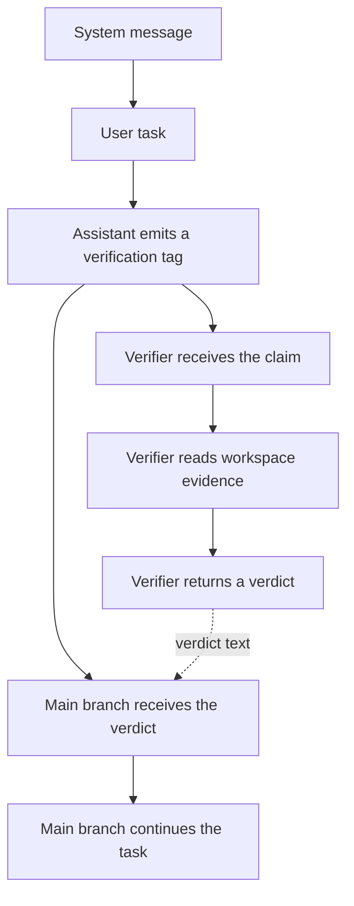

# Reflect design

## The coding loop

`refl` sends the active conversation to the OpenAI-compatible chat endpoint in `llama-server`. The model can inspect UTF-8 files with `read_file` and `grep_search`, run Bash commands with `bash`, and make changes with `write_file` and `edit_file`. Reflect executes calls in the order they appear and returns each observation with the corresponding tool call ID. The terminal lists each call with its command, path, or search pattern. The model continues until it returns a final answer or reaches the request limit.

The CLI and file tools use Python filesystem APIs on all platforms. PowerShell and MSYS2 launch the same CLI. The `bash` tool invokes Bash from the workspace directory. On Windows, Bash can come from MSYS2 or Git for Windows. `rg` is an external executable used by `grep_search` on all four target platforms.

The launch directory is the workspace unless `--workspace` selects one explicitly. An empty workspace can start a session. When `REFLECT.md` exists at the workspace root, the model reads it as project guidance. The file tools preserve existing instructions and configuration from other coding agents, and allow writes in their skill directories. Bash runs with the launching user's permissions and receives the project's preservation rule as model guidance.

## Conversation trees

Each session starts with a system message and a main branch. Each node records its ID, parent ID, branch type, status, and the chat message, including any tool calls or tool results. The `main_head` in the session file points to the active conversation node. Following parent IDs back to the root and reversing that path reconstructs the conversation for a given branch.



Solid arrows are parent links in the saved tree. The dotted arrow is the verdict copied into the main conversation. A verifier's tool calls and observations remain on its branch. Nodes from a fork with a usable verdict are marked `merged`. Forks that fail or exhaust the request budget are marked `pruned` and retained in the session for inspection.

Reflect writes UTF-8 JSON to `.refl/sessions/<session-id>.json` at startup, when it accepts a prompt, and after each completed model and tool round. It writes to a temporary file in the same directory and replaces the session file once the snapshot is complete. The session ID includes a UTC timestamp and a unique suffix. Session files can hold prompts, file contents, and command output, so Reflect adds a `.gitignore` to `.refl/sessions/` and `.refl/strategies/` that keeps Git from tracking them in any workspace. It leaves an existing `.gitignore` in those directories unchanged.

```text
refl --workspace ./project --resume SESSION_ID "Continue with the next step."
```

Resuming copies the saved tree into a new session file and continues from the saved active node. The copied tree includes earlier forks. A saved turn interrupted before a final answer is closed with a brief transcript note when the next prompt begins. The CLI prints the new session ID at startup. Reflect builds the system prompt for each request, so a resumed session follows the current instructions and the `--linear` setting.

`/tree` displays every branch and marks the current node. The newest continuation of a node stays at the same indentation, and earlier branches such as forks are indented above it. `/checkout <node_id>` can select a main, verification, or reflection node. The next prompt extends the selected path, and earlier branches remain visible in the tree. If the selected node falls inside a tool round, Reflect adds skipped results for tool calls still awaiting a result. The next task operates on the workspace as it exists when the task starts.

## Verification forks

1. The main model sees the entire conversation along the active path. Its system prompt asks it to emit `<verify>specific claim</verify>` before relying on an unchecked assumption about a file, API, or config key.
2. After the model reply completes, Reflect extracts distinct nonempty claims from its visible text. Tool calls accompanying a tag receive a deferred observation. The model can reissue a call after seeing the verdict. A claim already checked in the current task keeps its verdict until a main-branch Bash command or file change could alter the evidence, so restating it in a final answer ends the turn.
3. Reflect forks from the latest main node and adds an instruction naming the claim. Each verifier receives the conversation up to the fork point with a verification-specific system prompt. Multiple claims in one reply start concurrently. `llama-server` schedules them on its available slots.
4. Each verifier gets up to three model requests. It can locate evidence with `read_file` or `grep_search`. Reflect also checks the tool name before dispatch, so any attempted shell command or write stays unexecuted.
5. Once a lookup succeeds, a verdict request contains the claim and the fresh workspace evidence. It uses `llama-server`'s JSON response format to request an explanation and a status of `supported`, `contradicted`, or `insufficient`. Reflect displays these as `VERIFIED`, `FALSE ASSUMPTION`, and `UNVERIFIED`. A useful explanation cites the file and line. If the request budget runs out or the server fails to provide a usable verdict, Reflect passes back `UNVERIFIED`.
6. Reflect adds the verdicts to the main conversation and requests the next main response. Any further edits or commands run through the main branch's regular tool loop.

`--no-verify` omits the verification instruction and skips verification forks while keeping strategic reflection. `--linear` skips both kinds of forks.

The verdict records the model's interpretation. The saved tool observation gives reviewers access to the evidence behind it. Live tests with a small model showed that a correct file read can still lead to an incorrect verdict label.

Verification tests can exercise a claim that changes after an edit. Start with `status.txt` containing `old_ready`, check the claim with a tag, and let the main branch replace the value. Resume the session and check the old claim again. In the saved tree, the initial verdict should precede the edit, and the later verifier should report the old claim as false.

## Strategic reflection

Reflect checks up to four actual main-branch tool results from the current task. It starts a reflection batch when it observes one of these patterns.

- Two consecutive failures for the same action, or the same failure from two calls to the same tool.
- Two writes to the same file that leave its bytes unchanged.
- Three calls with the same action and unchanged results, including a command that repeatedly exits successfully with the same output.
- Three changes to the same file without a successful Bash result between them.
- Three identical failures from the same call during a task, even with edits between the runs. Fractional numbers such as test durations are ignored when comparing the results.

Each batch runs three reviewers with different roles. Reflect saves their branches and summarizes their proposals in the main conversation. The main branch starts with the cheapest idea whose failure it can detect quickly, runs its check, and moves on if it fails. Three parallel slots let the server work on all three reviewers at once. On a single slot they run one after another.

The request limit covers the main loop and its forks. Automatic reflection starts when the budget can cover the reviewers plus at least two main requests. If the turn reaches its last request after reflection, it uses that request for a Bash smoke check and reports the observed result. If the model answers in text instead, Reflect returns that answer.

`/reflect` starts a batch on the current conversation on demand. It records the proposals and waits for the next task. Automatic reflection pacing applies to detections from tool results.

### Reviewer roles

Reviewers that share the same context, tools, and prompt tend to return the same idea. In a test with a 27B model, three fixed lenses gave one distinct proposal in each of six reflections. Reflect therefore picks each batch's reviewers from a pool of roles, and the roles differ in what they see, which tools they have, and what kind of idea they return.

| Group | Role | Looks for | Sees |
| --- | --- | --- | --- |
| Grounded | Existing patterns | A project skill, commit, or working example to reuse | Conversation, tools, skills, recent commits |
| Grounded | Diagnosis | Two or three competing causes and one check that tells them apart | Conversation, tools |
| Grounded | Observe | A value the main branch assumes instead of printing | Conversation, tools |
| Alternative | Known alternative | An established technique or tool for this kind of problem | Summary, tools |
| Alternative | Switch tools | The same step with a different tool or language | Summary |
| Alternative | Shrink the problem | A minimal reproduction, a single case, or a bisection | Summary |
| Alternative | Premortem | Why the approach being repeated will fail | Conversation |
| Lateral | Analogy | A field where a problem with the same structure is solved routinely | Summary |
| Lateral | Naive shortcut | The simplest thing that might work, without proof | Summary |
| Lateral | Inversion | A constraint that may be optional, or the goal turned around | Summary |
| Lateral | Backtrack | The earliest decision that led into the dead end | Conversation |
| Lateral | Ask the user | The one question whose answer would unblock the task | Summary |

The summary holds the task prompt, the reason for reflecting, the latest six main-branch actions with their results, and the names at the workspace root. Each write or edit in it shows an excerpt of what changed, so a reviewer can tell which fixes were already tried. Roles that see only the summary cost one short request and do not inherit the main branch's framing. Roles with tools get one request to inspect the workspace and a second to answer. Existing patterns joins only when the workspace has project skills or Git history.

A reflection temperature sets the mix of groups. It starts at 0 for the first batch in a task and rises by one with each further batch, up to 2. It drops back to 0 when a failing command passes or an unchanged file finally changes, and with each new task. `/reflect` uses temperature 2.

| Temperature | Groups |
| --- | --- |
| 0 | Grounded, grounded, alternative |
| 1 | Grounded, alternative, lateral |
| 2 | Alternative, lateral, lateral |

Within a group, Reflect prefers roles not yet used in the task, then roles that suit the stall. A repeated failure suits roles such as Diagnosis and Switch tools, and a result that never changes suits roles such as Known alternative and Premortem. Alternative and lateral roles also sample at a higher model temperature.

Every reviewer answers in the same fields: the proposal, its basis, the cost of trying it, and the result that would show it failed. Ideas may be unverified, so each must be cheap to rule out. The Analogy role first restates the problem in abstract terms without words from the project's domain: the parts, how they relate, the goal, and what blocks it. Only then does it name a field with the same structure, map the parts, and give one concrete step. Simulated annealing came about the same way, when the cooling of metals was mapped onto the travelling salesman problem.

The Existing patterns role gets up to six recent Git commit subjects and opens an explicitly mentioned project skill or the workspace's sole skill as a starting point. These sources can point to a working baseline.

### Reflection pacing

Reflect adapts to observed results during the session. After each reflection batch, it waits for at least two new tool results before starting another. Further batches without a recovery raise that interval to four and then eight results. The delay resets if a recently failing command passes or a file that recently stayed unchanged finally changes. Reflect also suppresses repeat reviews for the same pattern within a task. A new user prompt starts a fresh observation window, and the pacing is saved with the session so `--resume` carries it forward.

A single failed attempt gives the model room to recover. The throttle uses observed results across model sizes. Repeated output is a signal to investigate, and a reviewer can propose a direct check on the artifact or milestone if the shell output alone gives little evidence of progress.

If a reviewer discovers a useful tool, the main branch can try it and record the successful command for future work. [Project skills](project-skills.md)

The project retrospectives add a useful question for reviewers. Check whether the expected milestone or artifact advanced even when the command reports success. Match the scenario and environment when comparing results. [Lessons from two development retrospectives](retrospective-lessons.md)

### Skills and Strategy

The CLI shows a **Skills** block when a note is read or saved. A **Strategy** block shows why reflection started, the proposals that came back, and the main-branch tool attempts that follow. Reflect records those attempts and their results in `.refl/strategies/<session-id>.md`. The session tree keeps the full tool observations. A future findings view can follow an action to its observed outcome and link each entry back to the relevant command, result, or file.

- **x86 disassembler found.** Show the executable and the successful discovery or version check. If the project installed it, link to the install result and the follow-up check.
- **Assembler tutorial saved.** Show the source and local path, and link to the tool result that confirmed the saved file could be read.
- **DSP ↔ CPU communication moved from I/O to SSI/DMA.** Link to the implementation and the check of the new path. Include a before-and-after timing result when both runs used the same workload.
- **Workflow saved as a project skill.** Link to the skill and the command and input that demonstrated it.

An entry can start with the current attempt and update as evidence arrives. A result that changes the next action can link to the strategy decision and its rationale. A result that improves a repeatable workflow can link to the skill it creates or updates. The tree holds the detailed investigation and the skill file holds the steps worth reusing.
