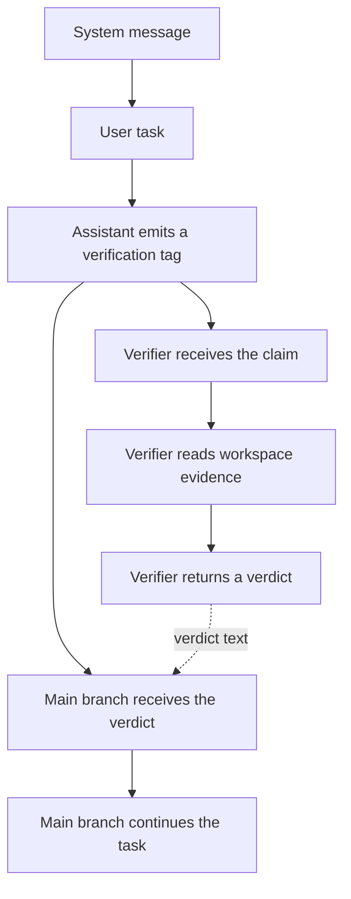

# Reflect design

## The coding loop

`refl` sends the active conversation to the OpenAI-compatible chat endpoint in `llama-server`. The model can inspect UTF-8 files with `read_file` and `grep_search`, run Bash commands with `bash`, and make changes with `write_file` and `edit_file`. Reflect executes calls in the order they appear and returns each observation with the corresponding tool call ID. The terminal lists each call with its command, path, or search pattern. The model continues until it returns a final answer or reaches the request limit.

The session stores each tool result as JSON. Requests give it to the model as plain text: the output, preceded by an `Error:` or `Exit code:` line when present. In a JSON string, file contents carry escapes such as `\"` and `\n`. A 4B model copied those escapes into `edit_file` arguments, which then did not match the file. With plain-text results, its replayed edits matched the file in 24 of 34 cases instead of 9 of 41.

`edit_file` first looks for a literal match. If there is none, it accepts a unique match that differs only in blank lines and trailing spaces, with indentation unchanged, and says so in its result. The 4B model often copied a block with one blank line where the file had two. Replayed through this fallback, 24 of 34 failed edits from three of its benchmark rounds succeeded. An `old_text` that starts with the line numbers from `read_file` gets an error saying to leave them out.

Some chat templates, such as Gemma 4's, render an assistant's text after the results of its tool calls and close the turn there. The model then reads its stated plan after the result and repeats the call. Before the first request, Reflect renders a short probe conversation through `llama-server`'s `/apply-template` endpoint. If the template moves the text, Reflect sends each reply that has both text and tool calls as two consecutive assistant messages. These templates join them into one model turn in the original order. The saved session keeps the reply as one message. A server without the endpoint gets the messages unchanged.

Reflect builds the system prompt for each request from its current instructions, the project's `REFLECT.md`, and the list of project skills. A resumed session therefore follows the current instructions and the current `--linear`, `--no-verify`, and `--thinking` settings.

The CLI and file tools use Python filesystem APIs on all platforms. PowerShell and MSYS2 launch the same CLI. The `bash` tool invokes Bash from the workspace directory. On Windows, Bash can come from MSYS2 or Git for Windows. `rg` is an external executable used by `grep_search` on all four target platforms.

The launch directory is the workspace unless `--workspace` selects one explicitly. An empty workspace can start a session. The file tools preserve existing instructions and configuration from other coding agents, and allow writes in their skill directories. Bash runs with the launching user's permissions and receives the project's preservation rule as model guidance.

## Conversation trees

Each session starts with a system message and a main branch. Each node records its ID, parent ID, branch type, status, and the chat message, including any tool calls or tool results. The `main_head` in the session file points to the active conversation node. Following parent IDs back to the root and reversing that path reconstructs the conversation for a given branch.



Solid arrows are parent links in the saved tree. The dotted arrow is the verdict copied into the main conversation. A fork's tool calls and observations remain on its branch. Nodes from a fork with a usable result are marked `merged`. Forks that fail or exhaust the request budget are marked `pruned` and retained in the session for inspection.

Reflect writes UTF-8 JSON to `.refl/sessions/<session-id>.json` at startup, when it accepts a prompt, and after each completed model and tool round. It writes to a temporary file in the same directory and replaces the session file once the snapshot is complete. The session ID includes a UTC timestamp and a unique suffix. Session files can hold prompts, file contents, and command output, so Reflect adds a `.gitignore` to `.refl/sessions/` and `.refl/strategies/` that keeps Git from tracking them in any workspace. It leaves an existing `.gitignore` in those directories unchanged.

```text
refl --workspace ./project --resume SESSION_ID "Continue with the next step."
```

Resuming copies the saved tree into a new session file and continues from the saved active node. The copied tree includes earlier forks. A saved turn interrupted before a final answer is closed with a brief transcript note when the next prompt begins. The CLI prints the new session ID at startup.

`/tree` displays every branch and marks the current node. The newest continuation of a node stays at the same indentation, and earlier branches such as forks are indented above it. `/checkout <node_id>` can select a main, verification, or reflection node. The next prompt extends the selected path, and earlier branches remain visible in the tree. If the selected node falls inside a tool round, Reflect adds skipped results for tool calls still awaiting a result. The next task operates on the workspace as it exists when the task starts.

## Verification forks

1. The main model sees the entire conversation along the active path. Its system prompt asks it to emit `<verify>specific claim</verify>` before relying on an unchecked assumption about a file, API, or config key.
2. After the model reply completes, Reflect extracts distinct nonempty claims from its visible text. Tool calls accompanying a tag receive a deferred observation. The model can reissue a call after seeing the verdict. A claim already checked in the current task keeps its verdict until a main-branch Bash command or file change could alter the evidence, so restating it in a final answer ends the turn.
3. Reflect forks from the latest main node and adds an instruction naming the claim. Each verifier receives the conversation up to the fork point with a verification-specific system prompt. Multiple claims in one reply start concurrently. `llama-server` schedules them on its available slots.
4. Each verifier gets up to three model requests. It can locate evidence with `read_file` or `grep_search`. Reflect also checks the tool name before dispatch, so any attempted shell command or write stays unexecuted.
5. Once a lookup succeeds, a verdict request contains the claim and the fresh workspace evidence. It uses `llama-server`'s JSON response format to request an explanation and a status of `supported`, `contradicted`, or `insufficient`. Reflect displays these as `VERIFIED`, `FALSE ASSUMPTION`, and `UNVERIFIED`. A useful explanation cites the file and line. If the request budget runs out or the server fails to provide a usable verdict, Reflect passes back `UNVERIFIED`.
6. Reflect adds the verdicts to the main conversation and requests the next main response. Any further edits or commands run through the main branch's regular tool loop.

`--no-verify` omits the verification instruction and skips verification forks while keeping strategic reflection. `--linear` skips both kinds of forks.

The verdict records the model's interpretation. The saved tool observation gives reviewers access to the evidence behind it. Live tests with a small model showed that a correct file read can still lead to an incorrect verdict label.

Verification tests can exercise a claim that changes after an edit. Start with `status.txt` containing `old_ready`, check the claim with a tag, and let the main branch replace the value. Resume the session and check the old claim again. In the saved tree, the initial verdict should precede the edit, and the later verifier should report the old claim as false.

## Strategic reflection

Reflect watches the actual main-branch tool results of the current task and starts a reflection batch when it sees one of these patterns. The first four look at the latest four results. The other four look at the whole task.

- Two consecutive failures for the same action, or the same failure from two calls to the same tool.
- Two writes to the same file that leave its bytes unchanged.
- Three calls with the same action and unchanged results, including a command that repeatedly exits successfully with the same output.
- Three changes to the same file without a successful Bash result between them.
- Three identical failures from the same call, even with edits between the runs. Fractional numbers such as test durations are ignored when comparing the results.
- A Bash command that has run at least four times returns a result it already returned earlier, but not the one just before it. This catches edits that go back and forth. The exit code does not matter, because a command such as `python check.py; cat report.txt` exits successfully even when the check fails. Repeating a passing check returns the same result twice in a row and does not count.
- The model gives a final answer while the latest Bash command still fails and that command has run at least twice in the task. A small model often stopped this way, announcing a next step it never took. A single failed command does not count, because it can be the answer itself, as in checking whether a tool is installed. Instead of ending the turn, Reflect starts a batch and the main branch continues.
- Ten tool results in a row change no file while a Bash command that failed earlier in the task has not passed since. This catches activity that never converges, such as a new debugging script each time, where no action or result repeats. Without a failing command, such as during a pure investigation, a long stretch of reads does not count. Replayed over 471 recorded benchmark runs, the rule fired in 21 failed runs, 20 of them early enough to pay for a reflection, and in none of the 363 solved ones. A limit of 15 caught only 9 failed runs in time, and a limit of 8 also fired in 13 solved runs.

For this rule and the previous one, a command also counts as failing when its output carries a test runner's or Python's failure report, such as `FAILED (failures=10)`, `1 failed`, or a traceback. Models often pipe a test run through `tail`, which exits successfully even when the tests fail.

### Reflection batches

Each batch runs three read-only reviewers with different roles. Three parallel slots let the server work on all three at once. On a single slot they run one after another. Reflect saves their branches and adds their proposals to the main conversation in two groups. Evidence-based ideas come from the grounded roles, which inspect the workspace. Unverified ideas come from the other roles.

The main branch then makes one request without tools to choose an idea. It states the observations the idea explains and its first step, and then names the reviewer. Naming the reviewer last keeps the label consistent with the plan. When the reviewer came first, a 4B model sometimes named one reviewer and described another's idea. Reflect keeps that plan in the conversation and asks the main branch to carry it out. The instructions ask it to prefer the evidence-based idea that explains the most of what it observed, to try unverified ideas only when the evidence does not settle the question, and not to return to the edits or commands it repeated before the reflection. Without this step, a model without thinking sometimes started with the cheapest idea and went back to its loop even when a reviewer had named the cause. [Results so far](benchmark-plan.md#results-so-far)

The request limit covers the main loop and its forks. Automatic reflection starts only when the budget can cover the reviewers, the decision request, and at least two main requests. If the turn reaches its last request after reflection, it uses that request for a Bash smoke check and reports the observed result. If the model answers in text instead, Reflect returns that answer.

`/reflect` starts a batch on the current conversation on demand. It records the proposals and waits for the next task, so it skips the decision step. Automatic reflection pacing applies only to detections from tool results.

### Reviewer roles

Reviewers that share the same context, tools, and prompt tend to return the same idea, as the three fixed lenses of earlier versions did. Reflect therefore picks each batch's reviewers from a pool of roles, and the roles differ in what they see, which tools they have, and what kind of idea they return.

| Group | Role | Looks for | Sees |
| --- | --- | --- | --- |
| Grounded | Existing patterns | A project skill, commit, or working example to reuse | Conversation, tools, skills, recent commits |
| Grounded | Diagnosis | Two or three competing causes and one check that tells them apart | Conversation, tools |
| Grounded | Observe | A value the main branch assumes instead of printing | Conversation, tools |
| Grounded | Prerequisites | Whether the tools, versions, dependencies, loaded files, and configuration that the failing step needs are in place and working | Conversation, tools |
| Alternative | Known alternative | An established technique or tool for this kind of problem | Summary, tools |
| Alternative | Switch tools | The same step with a different tool or language | Summary |
| Alternative | Rebuild and swap | Which part holds the fault, by rewriting parts independently and swapping them in one at a time | Summary, tools |
| Alternative | Shrink the problem | A minimal reproduction in a new file, a single case, or a bisection | Summary |
| Alternative | Premortem | Why the approach being repeated will fail | Conversation |
| Lateral | Analogy | A field where a problem with the same structure is solved routinely | Summary |
| Lateral | Naive shortcut | The simplest thing that might work, without proof | Summary |
| Lateral | Inversion | A constraint that may be optional, or the goal turned around | Summary |
| Lateral | Backtrack | The earliest decision that led into the dead end | Conversation |
| Lateral | Ask the user | The one question whose answer would unblock the task | Summary |

The summary holds the task prompt, the reason for reflecting, the latest six main-branch actions with their results, and the names at the workspace root. Each write or edit in it shows an excerpt of what changed, so a reviewer can tell which fixes were already tried. Roles that see only the summary cost one short request and do not inherit the main branch's framing. Roles with tools get one request to inspect the workspace and a second to answer. The first request sets `tool_choice` to `required` and asks for a check of something the main branch has not looked at yet. Without that, a 4B model's reviewers proposed checks instead of running them. They made 8 tool calls in 30 reflections, and their ideas repeated the main branch's guesses. With the setting, the Observe reviewer read `report.py` in `opaque-report` and found the capitalization bug that the main branch then fixed. Reviewers that investigate are also told not to assume anything that no tool result shows, including the main branch's beliefs about the files, tools, and environment. In `shadowed-module`, a 4B model and its Diagnosis reviewer both took for granted that the test ran the `app.py` being edited. The Prerequisites role checks such things directly: the interpreter or tool and its version, the dependencies, the file or module actually loaded, and the configuration in effect. It joins from the second batch in a task, so the first batch keeps Diagnosis and Observe. Existing patterns joins only when the workspace has project skills or Git history. It gets up to six recent Git commit subjects and opens an explicitly mentioned project skill or the workspace's sole skill as a starting point.

A reflection temperature sets the mix of groups. It starts at 0 for the first batch in a task and rises by one with each further batch, up to 2. It drops back to 0 when a failing command passes or an unchanged file finally changes, and with each new task. `/reflect` uses temperature 2.

| Temperature | Groups |
| --- | --- |
| 0 | Grounded, grounded, alternative |
| 1 | Grounded, alternative, lateral |
| 2 | Alternative, lateral, lateral |

Within a group, Reflect prefers roles not yet used in the task, then roles that suit the stall. Reflect tells three kinds of stall apart:

- **Failure.** The same action fails twice in a row, which usually points to a tool or usage problem. It suits roles such as Diagnosis and Switch tools.
- **Unfixed failure.** A check fails the same way although the code changed between runs, or the model answers while it still fails. It suits roles such as Diagnosis, Rebuild and swap, and Premortem.
- **No progress.** A result never changes. It suits roles such as Known alternative and Premortem.

Rebuild and swap treats the code as something to bisect. When a check only says that the result is wrong, rewriting one part from the spec and swapping it in shows whether that part holds the fault, without needing to know which rule was broken. Running the original and the rebuilt part on the same inputs is the comparison form of the same idea. Alternative and lateral roles also sample at a higher model temperature. With a reasoning model, most of a reviewer's time goes into its thinking step, and `--thinking main` skips that step for the forks.

Every reviewer answers in the same fields: the proposal, its basis, the cost of trying it, and the result that would show it failed. Ideas may be unverified, so each must be cheap to rule out, and none may contradict the task's stated requirements. The Analogy role first restates the problem in abstract terms without words from the project's domain: the parts, how they relate, the goal, and what blocks it. Only then does it name a field with the same structure, map the parts, and give one concrete step. Simulated annealing came about the same way, when the cooling of metals was mapped onto the travelling salesman problem.

### Reflection pacing

Reflect adapts to observed results during the session. After each reflection batch, it waits for at least two new tool results before starting another. Further batches without a recovery raise that interval to four and then eight results. The delay resets if a recently failing command passes or a file that recently stayed unchanged finally changes. Reflect also suppresses repeat reviews for the same pattern within a task. A new user prompt starts a fresh observation window, and the pacing is saved with the session so `--resume` carries it forward.

A single failed attempt gives the model room to recover. Repeated output is a signal to investigate, and a reviewer can propose a direct check on the artifact or milestone when the shell output alone gives little evidence of progress.

### Skills and Strategy

The CLI shows a **Skills** block when a note is read or saved. A **Strategy** block shows why reflection started, the temperature and roles, the proposals that came back, the chosen plan, and the main-branch tool attempts that follow. Reflect records the same in `.refl/strategies/<session-id>.md`, and the session tree keeps the full tool observations.

If a reviewer discovers a useful tool, the main branch can try it and record the successful command as a project skill. [Project skills](project-skills.md)

The project retrospectives add a useful question for reviewers. Check whether the expected milestone or artifact advanced even when the command reports success. Match the scenario and environment when comparing results. [Lessons from two development retrospectives](retrospective-lessons.md)

A possible extension is a findings view that follows each action to its observed outcome. Each entry could link back to the command, result, or file that supports it, to the strategy decision that led to it, and to the skill it created or updated.
